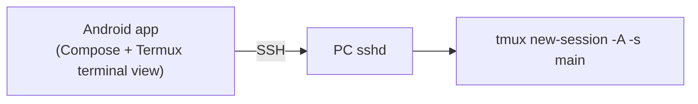
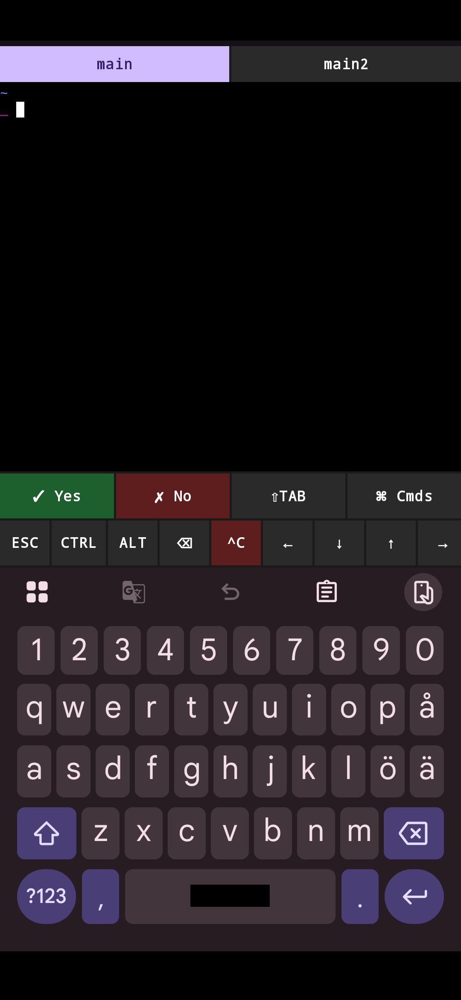
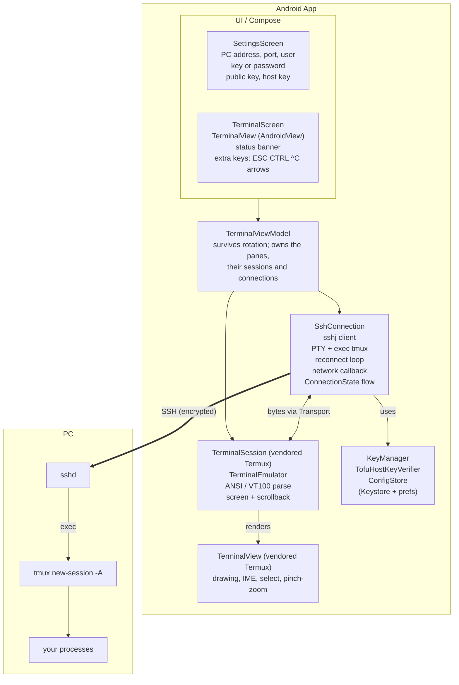
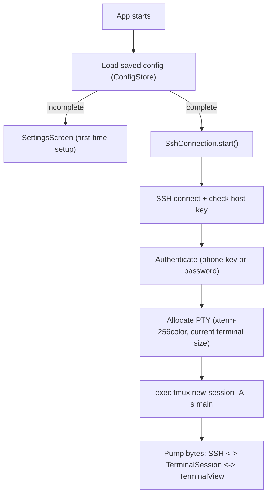
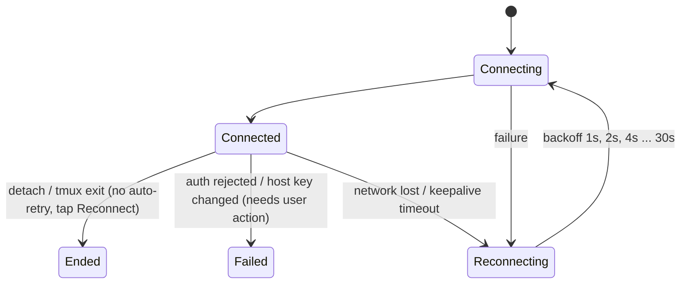

# Remote Terminal

Android app that opens straight into a tmux session on your PC over SSH.





- Connects automatically on launch and attaches to (or creates) the tmux session.
- Reconnects automatically: on Wi-Fi/mobile switches immediately, otherwise with backoff (1s → 30s).
  Keepalives detect a dead link within ~30s. tmux keeps your session alive in between.
- Detaching (`prefix d`) or exiting tmux stops auto-reconnect; tap **Reconnect** to reattach.
- Auth with a key pair generated on the phone (ECDSA P-256; the private key is encrypted with an
  Android Keystore key), or with a password.
- Host keys are trusted on first use; a changed key blocks the connection until you accept it.
- Two terminal tabs: the second attaches to its own tmux session (`main2`) and connects lazily.
- Extra key row: ESC, sticky CTRL/ALT, backspace, `^C`, arrows, PGUP/PGDN, `| - / ~`, and a settings
  button. Pinch to zoom, long-press to select/copy (with cursor handles).
- AI CLI helpers (Claude Code etc.): **✓ Yes** / **✗ No** / **⇧TAB** quick-answer keys and a dropdown of quick
  commands (`/clear`, `/model`, `/status`, `git status`, ...).
- Prompt detection: when the terminal shows an approval/confirmation prompt (`(y/n)`, "Do you want
  to", ...) while the app is in the background, it posts a notification.
- Mouse-tracking apps (tmux `mouse on`, etc.) get touch scrolling as mouse wheel events.

<details open>
<summary><h2>Prerequisites</h2></summary>

**On the PC:** `sshd` running and `tmux` installed.

**To build the app:**

| Requirement | Version |
|---|---|
| JDK | 25 (Gradle daemon toolchain, see `gradle/gradle-daemon-jvm.properties`) |
| Gradle | 9.6.0 (via the included wrapper, no install needed) |
| Android Gradle Plugin | 9.4.1 |
| Kotlin | 2.2.10 |
| Android SDK | Platform 35 + build-tools (Android Studio or command-line tools) |
| `adb` | Only to install from the command line |

**On the phone:** Android 8.0+ (minSdk 26). Notification permission is requested for prompt alerts.

Create `local.properties` with `sdk.dir=/path/to/Android/Sdk` if your IDE doesn't (it is gitignored).

</details>

<details open>
<summary><h2>PC setup</h2></summary>

1. Make sure `sshd` and `tmux` are installed and sshd is running (`sudo systemctl enable --now sshd`).
2. Find the PC's LAN IP (`ip -4 addr`) — a static DHCP lease makes life easier.
3. Open the app, enter IP, username, and copy/share the shown public key, then on the PC:
   ```sh
   echo 'ecdsa-sha2-nistp256 AAAA... remote-terminal@android' >> ~/.ssh/authorized_keys
   ```
4. Tap **Save & connect**.

Optional `~/.tmux.conf` niceties for a phone:
```
set -g mouse on          # tap to select panes, swipe to scroll
set -g aggressive-resize on
```

</details>

<details open>
<summary><h2>Build</h2></summary>

```sh
./gradlew assembleDebug
adb install app/build/outputs/apk/debug/app-debug.apk
```

</details>

<details open>
<summary><h2>Dependencies</h2></summary>

Versions are pinned in `gradle/libs.versions.toml`.

| Package | Version | Purpose |
|---|---|---|
| [sshj](https://github.com/hierynomus/sshj) | 0.40.0 | SSH client |
| BouncyCastle (`bcprov`, `bcpkix` jdk18on) | 1.81 | Key generation / crypto |
| kotlinx-coroutines-android | 1.10.2 | Async / reconnect loop |
| Jetpack Compose BOM + Material3 | 2026.02.01 | UI |
| AndroidX activity-compose | 1.10.1 | Compose host |
| AndroidX lifecycle (runtime/viewmodel-compose) | 2.9.4 | State handling |
| AndroidX core-ktx | 1.16.0 | Kotlin extensions |
| `terminal-emulator`, `terminal-view` | vendored | Termux terminal libraries |

The app is Kotlin with MVVM (`AndroidViewModel`) and `StateFlow`; persistence is `SharedPreferences`, and
the SSH key is wrapped with the Android Keystore (AES-GCM).

</details>

<details open>
<summary><h2>Project layout</h2></summary>

- `app/` — Compose UI, `SshConnection` (sshj, reconnect loop), `KeyManager`, `TofuHostKeyVerifier`,
  `KeepAliveService` (foreground service), `PromptNotifier` (prompt detection + notifications).
- `terminal-emulator/`, `terminal-view/` — vendored Termux terminal libraries (Apache 2.0, see `NOTICE.md`).

</details>

<details open>
<summary><h2>Limitations</h2></summary>

- A foreground service keeps the SSH session alive in the background, but Android may still kill it;
  the app then reconnects (and tmux reattaches) when you open it again.
- Reaching the PC from outside your LAN needs a VPN such as Tailscale/WireGuard; just use that address
  as the host.
- The saved password is stored unencrypted in `SharedPreferences` (encrypting it is on the TODO list).
  Prefer key authentication.

</details>

<details open>
<summary><h2>Architecture</h2></summary>



The important rule is to **keep SSH, the terminal, and the UI separate**. The only thing joining
SSH to the terminal is the small `TerminalSession.Transport` interface.

<details open>
<summary><h3>Connection flow</h3></summary>



The key command is:

```bash
tmux new-session -A -s main
```

It handles both cases, so the app never needs to know whether `main` already exists:

```text
tmux session exists         ──► attach to it
tmux session doesn't exist  ──► create it
```

The session name can be changed in Settings. A custom command can replace the whole thing, for example
when tmux isn't on the non-login `PATH`.

#### Why run tmux as the SSH command, not by typing it into a shell

We run tmux with `session.exec(command)` instead of starting a shell and writing `tmux …\r` into it.

- There's no race with the shell prompt and no echoed command on screen.
- When tmux exits or you detach, the SSH channel ends. That lets the app tell
  **"you detached"** (channel EOF, connection still up → `Ended`) apart from
  **"the network died"** (connection gone → reconnect).

</details>

<details open>
<summary><h3>SSH layer (<code>SshConnection</code>)</h3></summary>

sshj is used directly. The only interface between it and the terminal is:

```java
// terminal-emulator/.../TerminalSession.java
public interface Transport {
    void write(byte[] data, int offset, int count) throws IOException; // user input → PC
    void resize(int columns, int rows, int cellWidthPixels, int cellHeightPixels);
}
```

Output goes the other way via `TerminalSession.appendRemoteOutput(...)`. While connected,
`SshConnection` attaches a `Transport`. When the connection drops it detaches it, so the emulator, the
screen and the scrollback all survive reconnects.

If the SSH library ever needs to change, `SshConnection` is the only file that imports sshj.

</details>

<details open>
<summary><h3>Terminal layer</h3></summary>

This is the most important part of the project. A raw SSH stream isn't just text. Programs send control
sequences such as:

```text
ESC [ 2 J     clear screen
ESC [ H       move cursor home
ESC [ 31 m    red text
```

These have to be interpreted:

```text
SSH bytes
    │
    ▼
TerminalEmulator (VT100/ANSI/xterm parser)
    │
    ▼
Terminal state
    ├── characters + colors
    ├── cursor position
    ├── scrollback (5000 lines)
    └── screen dimensions
          │
          ▼
    TerminalView (Android View, hosted in Compose)
```

This is what makes `vim`, `htop`, `nano`, `git`, `top` and `tmux` itself behave like they do in a real terminal.

We reuse Termux's `terminal-emulator` and `terminal-view` instead of writing our own. The original
`TerminalSession` started a local process through JNI. It was rewritten to read and write a remote
`Transport`, and the native code was removed. See `NOTICE.md` for details.

Input on a phone needs help, so `TerminalScreen` adds an extra-key row:

- ESC, backspace and `^C` (SIGINT)
- sticky one-shot CTRL and ALT
- arrow keys, PGUP and PGDN, and `| - / ~`
- ✓ Yes / ✗ No / ⇧TAB quick answers for AI CLI prompts, and a quick-command dropdown

Long-press selects and copies text (with cursor handles), and pinch changes the font size. Touch
scrolling is sent as mouse-wheel events to apps that enable mouse tracking.

#### Panes

`TerminalViewModel` owns two panes (`PANE_COUNT = 2`), each with its own `TerminalSession` and
`SshConnection`. Pane 0 runs the configured command; pane 2 attaches to tmux session `<name>2`
(`main2`) and connects lazily the first time it is shown.

</details>

<details open>
<summary><h3>Reconnection</h3></summary>

This matters on Android because the network disappears when the phone switches between Wi-Fi and mobile data.

```kotlin
sealed interface ConnectionState {
    data object Idle : ConnectionState
    data class Connecting(val attempt: Int) : ConnectionState
    data object Connected : ConnectionState
    data class Reconnecting(val reason: String, val retryInSeconds: Int) : ConnectionState
    data class Failed(val reason: String, val hostKeyChanged: Boolean = false) : ConnectionState
    data object Ended : ConnectionState   // tmux exited or you detached
}
```



Reconnection is triggered in these ways:

- **Network change:** a `ConnectivityManager` default-network callback closes the old socket and
  reconnects immediately when Wi-Fi ↔ mobile switches. There's no waiting for a timeout.
- **Dead link:** keepalives every 10s, with 3 misses allowed, detect it within about 30s.
- **App resumed:** coming back to the foreground skips any remaining backoff.
- **Retry now:** a button in the status banner.

Because **tmux persists on the PC**, reconnecting is easy:

```text
Phone loses connection → SSH dies → tmux keeps running
→ phone reconnects → attach to "main" → everything is still there
```

`KeepAliveService` is a foreground service that keeps the sessions alive while the app is in the
background. If Android still kills the app, opening it again simply reconnects and reattaches.

#### Prompt detection

`PromptDetector` (in `PromptNotifier.kt`) scans the last 30 lines of the screen after output settles.
If it matches an approval or confirmation prompt (`(y/n)`, "Do you want to", "Esc to cancel", ...)
while the app is in the background, `PromptNotifier` posts an input-needed notification.

</details>

<details open>
<summary><h3>Security</h3></summary>

**Client key.** The phone generates its own ECDSA P-256 key pair:

```text
Android Keystore (AES-GCM key, never leaves the device)
       │ encrypts
       ▼
filesDir/id_ecdsa.enc  (SSH private key)
```

Settings shows the public key in `authorized_keys` format, with Copy and Share buttons and a "New key"
action. Password login is also supported.

**Host key (trust on first use).** The PC's key is stored as `type SHA256:fingerprint` per host and port:

```text
First connection ──► store fingerprint
Later connections ──► must match, otherwise Failed(hostKeyChanged)
                      └─► user taps "Trust new key" to accept the new one
```

Settings shows the trusted fingerprint, with a "Forget host key" action.

</details>

</details>

## Roadmap

See [TODO.md](TODO.md).

## License

Apache License 2.0, see `LICENSE-APACHE-2.0.txt`. The vendored Termux libraries are Apache 2.0 as well;
see `NOTICE.md` for their origin and our modifications.
